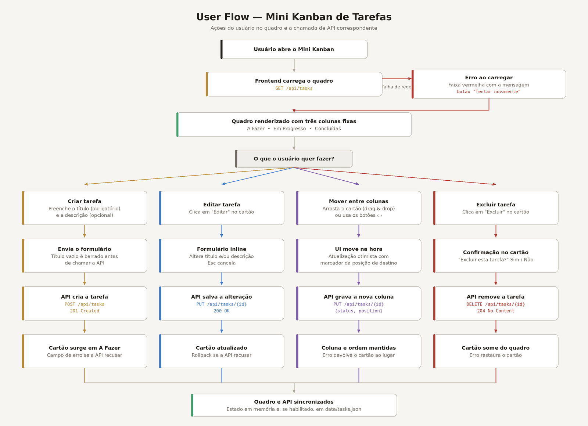
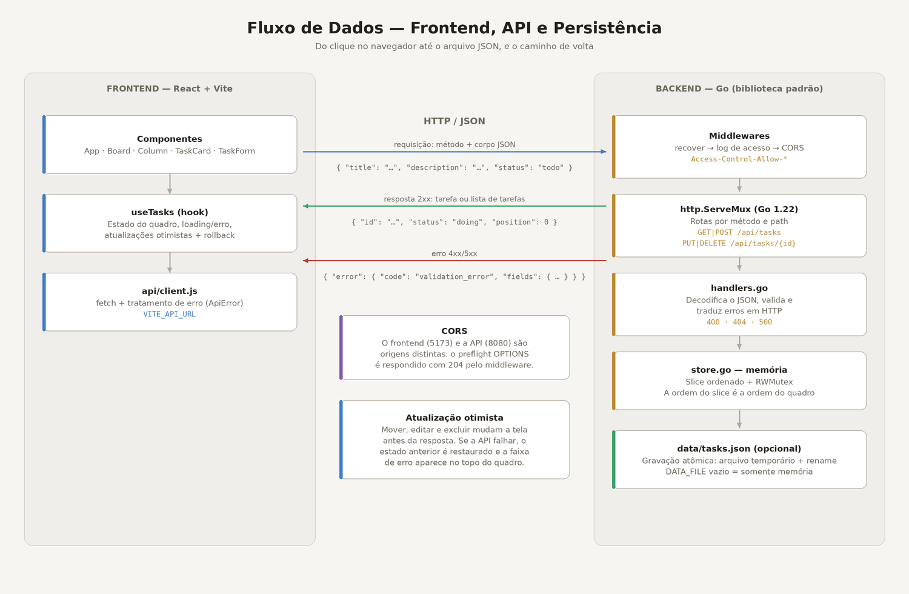

# Mini Kanban de Tarefas — Desafio Fullstack (React + Go)

Kanban com três colunas fixas — **A Fazer**, **Em Progresso** e **Concluídas** — com CRUD completo de
tarefas, movimentação por drag and drop (ou pelos botões `‹ ›`) e persistência via API REST em Go.



---


## O que este projeto demonstra

Desafio de estudo/portfólio relevante para **Desenvolvimento Júnior** e **Suporte de Sistemas Júnior**:

- **Desenvolvimento:** CRUD com React e API REST em Go, validação de dados, atualização otimista e persistência em JSON.
- **Investigação de falhas:** health check, logs de acesso com método/rota/status/duração e respostas de erro estruturadas.
- **Documentação e comunicação técnica:** fluxos do usuário e dos dados, decisões de implementação e limitações descritas para facilitar reprodução e manutenção.

Evidências: [`handlers.go`](backend/handlers.go), [`middleware.go`](backend/middleware.go), [`store.go`](backend/store.go), [`handlers_test.go`](backend/handlers_test.go) e [`useTasks.js`](frontend/src/hooks/useTasks.js).

## Diagnóstico no ambiente local

| Sintoma | Conferência sugerida |
|---|---|
| Quadro não carrega | Testar `GET /api/health`; conferir `VITE_API_URL`, porta e serviço da API. |
| Funciona via curl, mas não no navegador | Conferir a origem do frontend em `CORS_ORIGINS` e a resposta ao preflight. |
| Tarefa recusada com `400` | Conferir o corpo JSON e os motivos em `error.fields`. |
| Tarefas somem ao reiniciar | Verificar se `DATA_FILE` está vazio e, no Docker, se o volume de dados foi preservado. |
| Falha ao gravar ou iniciar o armazenamento | Conferir caminho/permissões de `DATA_FILE` e logs do backend; preservar uma cópia do JSON antes de alterar dados. |

Na execução por Compose, `docker compose ps` e `docker compose logs --tail=100` ajudam a localizar a etapa com erro. Registrar os passos e o resultado esperado antes de alterar a implementação.

## Sumário

- [Como rodar](#como-rodar)
- [API](#api)
- [Estrutura do projeto](#estrutura-do-projeto)
- [Decisões técnicas](#decisões-técnicas)
- [Documentação (User Flow e Fluxo de Dados)](#documentação)
- [Testes](#testes)
- [Limitações conhecidas](#limitações-conhecidas)
- [Melhorias futuras](#melhorias-futuras)

---

## Como rodar

Pré-requisitos: **Go 1.22+** e **Node 18+** (ou apenas **Docker**).

### 1. Backend

```bash
cd backend
go run .
```

API em `http://localhost:8080`. Health check: `curl http://localhost:8080/api/health`.

Variáveis de ambiente (todas opcionais):

| Variável       | Padrão            | Descrição                                                         |
| -------------- | ----------------- | ----------------------------------------------------------------- |
| `PORT`         | `8080`            | Porta HTTP.                                                       |
| `DATA_FILE`    | `data/tasks.json` | Arquivo de persistência. **Vazio** (`DATA_FILE=`) = só memória.   |
| `CORS_ORIGINS` | `*`               | Origens liberadas, separadas por vírgula (ex.: `http://localhost:5173`). |

### 2. Frontend

Em outro terminal:

```bash
cd frontend
npm install
npm run dev
```

Aplicação em `http://localhost:5173`.

O frontend aponta para `http://localhost:8080/api` por padrão. Para outro endereço, copie
`frontend/.env.example` para `frontend/.env` e ajuste `VITE_API_URL`.

### 3. Com Docker (opcional)

```bash
docker compose up --build
```

Frontend em `http://localhost:5173`, API em `http://localhost:8080`. Os dados ficam no volume
`kanban-data`, então sobrevivem a `docker compose down`.

---

## API

Base: `/api`. Todos os corpos são JSON (`Content-Type: application/json`).

| Método   | Rota          | Descrição                    | Respostas                  |
| -------- | ------------- | ---------------------------- | -------------------------- |
| `GET`    | `/health`     | Health check                 | `200`                      |
| `GET`    | `/tasks`      | Lista as tarefas do quadro   | `200`                      |
| `POST`   | `/tasks`      | Cria uma tarefa              | `201`, `400`               |
| `PUT`    | `/tasks/{id}` | Atualiza / move uma tarefa   | `200`, `400`, `404`        |
| `DELETE` | `/tasks/{id}` | Exclui uma tarefa            | `204`, `404`               |

### Modelo

```json
{
  "id": "b86a52d5bf8b8b4e",
  "title": "Revisar contrato",
  "description": "Cláusulas 4 e 7",
  "status": "todo",
  "position": 0,
  "createdAt": "2026-07-31T12:00:00Z",
  "updatedAt": "2026-07-31T12:03:21Z"
}
```

`status` aceita `todo` (A Fazer), `doing` (Em Progresso) e `done` (Concluídas).
`position` é o índice da tarefa **dentro da coluna**, começando em `0`.

### Exemplos

```bash
# criar
curl -X POST http://localhost:8080/api/tasks \
  -H 'Content-Type: application/json' \
  -d '{"title":"Revisar contrato","description":"Cláusulas 4 e 7"}'

# mover para "Em Progresso", no topo da coluna
curl -X PUT http://localhost:8080/api/tasks/{id} \
  -H 'Content-Type: application/json' \
  -d '{"status":"doing","position":0}'

# excluir
curl -X DELETE http://localhost:8080/api/tasks/{id}
```

O `PUT` é parcial: campos ausentes preservam o valor atual.

### Erros

Todo erro tem o mesmo formato, e erros de validação trazem o motivo por campo:

```json
{
  "error": {
    "code": "validation_error",
    "message": "dados invalidos",
    "fields": { "title": "titulo e obrigatorio" }
  }
}
```

Regras validadas: título obrigatório (após `trim`) e com até 120 caracteres, descrição com até 1000
caracteres, `status` restrito às três colunas e `position` não negativa.

---

## Estrutura do projeto

```
.
├── backend/
│   ├── main.go              # bootstrap, configuração por env, encerramento gracioso
│   ├── handlers.go          # rotas, decode/encode JSON, tradução de erros em HTTP
│   ├── models.go            # Task, inputs e validações
│   ├── store.go             # armazenamento em memória + persistência em JSON
│   ├── middleware.go        # CORS, log de acesso e recover
│   ├── handlers_test.go     # testes de integração da API
│   └── Dockerfile
├── frontend/
│   ├── src/
│   │   ├── api/client.js        # fetch + ApiError
│   │   ├── hooks/useTasks.js    # estado do quadro e ações (otimistas)
│   │   ├── components/          # Board, Column, TaskCard, TaskForm, Feedback
│   │   ├── constants.js         # as três colunas fixas
│   │   ├── App.jsx
│   │   └── styles.css
│   ├── package.json
│   └── Dockerfile
├── docs/
│   ├── user-flow.png            # obrigatório
│   ├── data-flow.png            # opcional
│   └── generate_diagrams.py     # script que gera os dois PNGs
├── docker-compose.yml
└── README.md
```

---

## Decisões técnicas

**Backend só com a biblioteca padrão.** O `net/http` do Go 1.22 já faz roteamento por método e path
(`PUT /api/tasks/{id}` + `r.PathValue("id")`), então não há dependência externa — nada de `go.sum`,
build rápido e menos superfície para revisar.

**A ordem do slice é a ordem do quadro.** O store guarda `[]*Task` e a posição de uma tarefa na
coluna é o índice dela entre as de mesmo status. Mover é remover e reinserir; `position` é calculada
na leitura. Isso evita manter contadores de ordem sincronizados (e o bug clássico de posições
duplicadas depois de excluir uma tarefa no meio da coluna).

**Persistência em arquivo, mas opcional.** O escopo mínimo pedia memória; o bônus, arquivo. Os dois
convivem: `DATA_FILE` vazio mantém tudo em memória. A gravação é atômica (arquivo temporário +
`rename`) e roda dentro do mesmo lock da mutação, então o JSON nunca fica pela metade. Se a gravação
falha, o estado em memória é revertido e a API responde `500` — memória e disco não divergem.

**`PUT` parcial.** Campos ausentes (`nil`) preservam o valor atual, o que deixa "mover" (`{status,
position}`) e "editar" (`{title, description}`) usarem o mesmo endpoint sem que um sobrescreva o
outro com valor vazio.

**Atualização otimista no frontend.** Mover, editar e excluir aplicam a mudança na hora e, se a API
recusar, restauram o estado anterior e mostram a faixa de erro. Criar espera a resposta, porque o
`id` vem do servidor. Enquanto uma requisição está em voo, só aquele cartão fica desabilitado
(`busyIds`) — o resto do quadro continua utilizável.

**Drag and drop nativo.** HTML5 (`draggable` + `dragover`/`drop`) resolve o caso sem adicionar
biblioteca. Como arrastar não funciona bem em teclado nem em leitores de tela, cada cartão também
tem os botões `‹ ›` para mover entre colunas — mesma ação, caminho acessível.

**Validação nos dois lados.** O formulário barra título vazio antes de chamar a rede (resposta
imediata) e o backend valida de novo, já que a API é pública. Os erros por campo devolvidos pela API
são exibidos no input correspondente.

**Sem gerenciador de estado global.** Um hook (`useTasks`) concentra dados e ações; para três
colunas e um recurso, Redux/Zustand só adicionaria cerimônia.

---

## Documentação

- **User Flow** (obrigatório): [`docs/user-flow.png`](docs/user-flow.png) — o caminho do usuário no
  sistema (carregar o quadro, criar, editar, mover e excluir), com a chamada de API de cada ação e os
  caminhos de erro.
- **Fluxo de Dados** (opcional): [`docs/data-flow.png`](docs/data-flow.png) — como o dado viaja entre
  componentes React, hook, cliente HTTP, middlewares, handlers, store em memória e arquivo JSON.



Os dois PNGs são gerados por `python3 docs/generate_diagrams.py` (requer Pillow), versionado junto
para que os diagramas acompanhem mudanças no fluxo.

---

## Testes

```bash
cd backend
go test ./...
```

Cobrem o caminho feliz e as bordas do CRUD: criação com `trim` no título, validações (título vazio,
status inválido) sem sujar o store, `PUT` parcial preservando campos, movimentação entre colunas,
reordenação dentro da coluna, `404` em id inexistente, `DELETE`, preflight CORS, corpo JSON inválido
e persistência sobrevivendo a um "restart" (novo store lendo o mesmo arquivo).

---

## Limitações conhecidas

- **Sem autenticação e sem multiusuário.** O quadro é único e global; qualquer um que alcance a API
  lê e escreve tudo. O `CORS_ORIGINS=*` padrão é conveniente para avaliar, não para produção.
- **Persistência em arquivo não escala.** Cada mutação reescreve o JSON inteiro sob um lock global —
  suficiente para um quadro pessoal, inadequado para volume alto ou várias instâncias.
- **Sem tempo real.** Duas abas abertas não se sincronizam sozinhas; é preciso usar "Atualizar".
- **Sem resolução de conflito.** Duas edições simultâneas na mesma tarefa: vence a última: não há
  `ETag`/`If-Match` nem controle de versão.
- **Testes automatizados só no backend.** O frontend foi validado manualmente (fluxos de criar,
  editar, mover, excluir, erro de rede e recarga da página).
- **Colunas fixas em código.** As três colunas são constantes no frontend e no backend, como pede o
  desafio; não há CRUD de colunas.

## Melhorias futuras

- Testes de frontend com Vitest + Testing Library e um teste end-to-end (Playwright) cobrindo o drag
  and drop.
- Trocar o arquivo JSON por SQLite/Postgres com migrações, mantendo a mesma interface de store.
- Reordenação vertical persistida também pelos botões (hoje `‹ ›` sempre soltam no fim da coluna).
- WebSocket ou SSE para refletir mudanças entre abas/usuários em tempo real.
- Filtro por texto, prazo e etiquetas nos cartões.
- Pipeline de CI rodando `go vet`, `go test` e `npm run build` a cada push.
